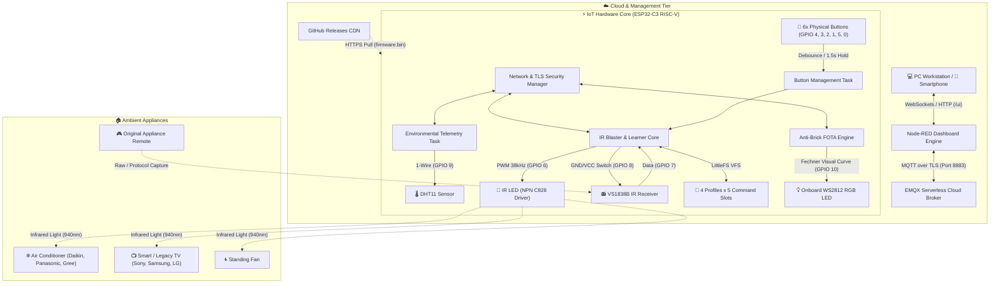

# Universal Smart IR Blaster & Climate Monitor (Zero-Brick FOTA Hub)

[](https://www.espressif.com/)
[](https://platformio.org/)
[](https://www.emqx.com/)
[](https://nodered.org/)
[](#14-license--confidentiality-notice)

---

## 1. Project Title

**Universal Smart IR Blaster & Climate Monitor (Zero-Brick FOTA Hub)**  
*Thiết bị Điều khiển Hồng ngoại Thông minh 2 Chiều & Giám sát Môi trường Tích hợp Cập nhật Firmware An toàn*

* **Course / Project:** Báo cáo & Đề xuất Đề tài Giữa kỳ môn Internet of Things (IoT)
* **Author / Developer:** Nguyễn Hoàng Đức ([@Nhdnguyenhoangduc](https://github.com/Nhdnguyenhoangduc))
* **Instructor:** Thầy Anh Tuấn Nguyễn
* **Public Repository:** [https://github.com/Nhdnguyenhoangduc/IOT_Smart_Remote](https://github.com/Nhdnguyenhoangduc/IOT_Smart_Remote)

---

## 2. Professional Project Overview

The **Universal Smart IR Blaster & Climate Monitor** is an industrial-grade, dual-mode IoT edge controller built on the ESP32-C3 RISC-V architecture. The system bridges the gap between conventional legacy home appliances (air conditioners, televisions, fans, audio systems) and modern cloud-managed smart building environments.

The device operates concurrently in two operating paradigms:
1. **Standalone Handheld Remote Control:** Equipped with tactile buttons and local Non-Volatile Flash Storage (LittleFS), allowing instantaneous execution of learned appliance commands and physical IR code capture without an active internet connection.
2. **Cloud IoT Edge Gateway:** Synchronized with an online MQTT message broker over encrypted TLS (Port 8883) and integrated with a Node-RED responsive dashboard, enabling bidirectional remote telemetry, automated climate-driven controls, and secure firmware lifecycle management.

A core innovation of this project is its **Zero-Brick Remote Firmware Upgrade (FOTA) Engine**, which combines dual-partition flash rollback with visual optical feedback governed by human psychophysics (the Weber-Fechner law).

---

## 3. Project Motivation & Problem Statement

### Practical Problems in Modern Smart Homes:
1. **Appliance Remote Proliferation & Fragmentation:**  
   A typical household operates 4 to 8 distinct infrared remote controls. This fragmentation causes regular friction due to misplaced remotes, degraded batteries, and cluttered living spaces.
2. **Obsolete Non-Connected Household Appliances:**  
   Millions of high-power, reliable appliances (such as split-unit air conditioners and standing fans) lack internet interfaces. Replacing functional appliances solely for IoT integration is economically and ecologically wasteful.
3. **Firmware Brick Risk in Edge IoT Deployments:**  
   Standard DIY and consumer-grade ESP32 projects frequently experience unrecoverable bricking during Over-The-Air (OTA) updates when subjected to power interruptions, incomplete downloads, or erroneous firmware builds lacking verified fallback partitions.

### Proposed Solution:
This project delivers a robust, compact, and affordable edge device that non-invasively retrofits legacy IR appliances, measures real-time ambient environment metrics (temperature and humidity), and guarantees uninterrupted operational uptime through verified cryptographic FOTA rollback protections.

---

## 4. System Architecture Overview

The system architecture spans physical edge nodes, cloud message routing, and client presentation layers:



---

## 5. Key Verified Features

* **Hybrid Dual-Path Control:** Seamless switching between manual tactile operation (6 physical micro-switches) and cloud-driven commands from any web browser.
* **Universal Multi-Protocol IR Engine:** Supports standard consumer decoding (NEC, Sony SIRC, RC5/6, Samsung) and handles long raw pulse sequences (up to 700 timings) for complex HVAC remote protocols (Panasonic, Daikin, Mitsubishi).
* **Multi-Profile Storage:** Stores 4 distinct appliance profiles (Profile 0: TV, Profile 1: AC, Profile 2: Fan, Profile 3: Custom) with 5 independent command slots per profile in persistent LittleFS flash storage.
* **On-Demand Power-Gated IR Learning:** The IR receiving eye is power-switched via GPIO 8 only during active learning sessions (10-second timeout), eliminating optical interference and reducing power consumption.
* **Zero-Brick HTTPS FOTA with Rollback:** Dual-partition (`app0` / `app1`) flash design. Validates cryptographic SHA256 image checksums before activation. Enforces a 180-second post-flash health verification timer: if the new firmware fails to sustain network integrity, the bootloader automatically reverts to the previous stable release.
* **Psychophysically Calibrated Optical Indicator:** Single-wire WS2812 RGB LED calibrated to the Weber-Fechner law ($PWM = 254 \times (\% / 100)^{2.4} + 1$) to provide truly linear brightness perception during OTA downloads, WiFi handshakes, and IR operations.
* **Real-Time Climate Telemetry:** Periodic acquisition of room temperature and relative humidity via a DHT11 sensor with automatic publication over MQTT.

---

## 6. Hardware Specifications & Pin Configuration

| Component | Hardware Specification | ESP32-C3 Pin | Functional Role |
|:---|:---|:---:|:---|
| **Microcontroller** | ESP32-C3 Super Mini (RISC-V @ 160MHz, 4MB Flash) | — | Main System SoC |
| **IR Transmitter** | 940nm High-Power IR LED driven by NPN C828 Transistor | `GPIO 6` | 38kHz Carrier Pulse Generation |
| **IR Receiver** | VS1838B Photoreceiver (38kHz Optical Demodulator) | `GPIO 7` | Incoming Signal Demodulation |
| **IR Power Switch** | Transistor / Low-Side Switch for IR Receiver | `GPIO 8` | Dynamic Power Gating for Learner |
| **Status Indicator** | Addressable WS2812 NeoPixel RGB LED | `GPIO 10` | Non-blocking Optical Feedback |
| **Climate Sensor** | DHT11 Digital Temperature & Humidity Sensor | `GPIO 9` | 1-Wire Environmental Telemetry |
| **Button N1** | SPST Tactile Push Button | `GPIO 4` | Slot 0 Send / Hold 1.5s Learn |
| **Button N2** | SPST Tactile Push Button | `GPIO 3` | Slot 1 Send / Hold 1.5s Learn |
| **Button N3** | SPST Tactile Push Button | `GPIO 2` | Slot 2 Send / Hold 1.5s Learn |
| **Button N4** | SPST Tactile Push Button | `GPIO 1` | Slot 3 Send / Hold 1.5s Learn |
| **Button ON/OFF** | SPST Tactile Push Button | `GPIO 5` | Slot 4 (Power Toggle) |
| **Button FUNC** | SPST Tactile Push Button | `GPIO 0` | Profile Cycling (0 → 1 → 2 → 3) |

---

## 7. Technology Stack

* **Firmware Runtime:** C++ (ESP32 Arduino Core 3.x / FreeRTOS).
* **Development Environment:** PlatformIO Core (VSCode IDE / CLI).
* **Communication Middleware:** PubSubClient with WiFiClientSecure (TLS 1.2/1.3).
* **Cryptographic Verification:** MbedTLS (SHA256 hardware accelerated).
* **Flash Storage Subsystem:** LittleFS Virtual File System.
* **Infrared Protocol Library:** IRremoteESP8266 (optimized for ESP32-C3).
* **Cloud Broker:** EMQX Serverless Cloud Broker (`8883` MQTTS).
* **Telemetry & Supervisory Interface:** Node-RED Engine & Node-RED Dashboard (`node-red-dashboard`).

---

## 8. Communication Architecture & Protocol Specification

### MQTT Broker Details:
* **Host:** `xxxx.emqxsl.com` (EMQX Serverless Cloud)
* **Port:** `8883` (SSL / TLS Encrypted)
* **Security:** Username/Password Authentication + TLS Certificate Verification

### Topic Directory:

| Topic Pattern | Direction | QoS | Description |
|:---|:---:|:---:|:---|
| `ir/<DEVICE_ID>/status` | Device ➔ Cloud | 1 | Periodic health heartbeat and OTA state |
| `ir/<DEVICE_ID>/dht` | Device ➔ Cloud | 1 | Environmental telemetry (Temp & Humidity) |
| `ir/<DEVICE_ID>/learned` | Device ➔ Cloud | 1 | Decoded or raw captured IR telemetry |
| `ir/<DEVICE_ID>/cmd/ir/slot` | Cloud ➔ Device | 1 | Execute transmission of configured slot |
| `ir/<DEVICE_ID>/cmd/ir/profile`| Cloud ➔ Device | 1 | Change active appliance profile index |
| `ir/<DEVICE_ID>/cmd/ir/learn` | Cloud ➔ Device | 1 | Activate remote learning window |
| `ir/<DEVICE_ID>/cmd/ota` | Cloud ➔ Device | 1 | Trigger secure HTTPS firmware update |

### Sample Telemetry Payloads:

* **Status Heartbeat (`ir/<DEVICE_ID>/status`):**
```json
{
  "state": "online",
  "fw": "1.0.3",
  "rssi": -51,
  "heap": 117144,
  "info": "ready"
}
```

* **Environmental Telemetry (`ir/<DEVICE_ID>/dht`):**
```json
{
  "temp": 28.5,
  "hum": 65.0
}
```

* **Remote OTA Command (`ir/<DEVICE_ID>/cmd/ota`):**
```json
{
  "version": "1.0.3",
  "url": "https://github.com/Nhdnguyenhoangduc/IOT_Smart_Remote/releases/download/v1.0.3/firmware.bin",
  "sha256": "c874b33ad91503e3228a307b99a13b772e008a652a927fa1e5d3fc3c95982855"
}
```

---

## 9. System Workflows

### 9.1 Zero-Brick FOTA Upgrade & Rollback Workflow

```mermaid
sequenceDiagram
    autonumber
    actor Admin as Operator (Node-RED)
    participant Broker as EMQX Cloud (MQTTS)
    participant Device as ESP32-C3 Node
    participant GitHub as GitHub Releases (HTTPS)
    participant Bootloader as 2-Slot OTA Bootloader

    Admin->>Broker: Publish OTA command (URL, version, SHA256)
    Broker->>Device: Dispatch OTA command on `ir/+/cmd/ota`
    Device->>Device: Compare target version with running FW_VERSION
    Device->>GitHub: Open HTTPS Stream with SHA256 Stream Hasher
    loop Stream Chunks
        Device->>Device: Write chunk to inactive OTA partition (`app1`)
        Device->>Device: Update running Fechner LED progress (0% - 100%)
        Device->>Broker: Publish status (`state: ota_progress`, `info: X%`)
    end
    Device->>Device: Finalize image hash & verify against expected SHA256
    alt Hash Matches
        Device->>Bootloader: Set boot partition to `app1`
        Device->>Device: Graceful network teardown & Restart
        Device->>Device: Boot into new firmware; start 180s health countdown
        Device->>Broker: Connect to MQTT & publish online status
        Device->>Bootloader: Confirm firmware stability (`markValid()`)
    else Hash Mismatch or Stream Error
        Device->>Device: Abort flash write & discard partition
        Device->>Broker: Publish `state: ota_failed`
    end
```

### 9.2 Local IR Code Capture & Flash Persistence Workflow
1. User holds one of the 4 slot buttons (`N1` to `N4`) for 1.5 seconds, or triggers the Learn command from Node-RED.
2. LED changes to solid Orange and GPIO 8 energizes the VS1838B sensor.
3. The original remote control is pressed toward the receiver.
4. The signal is captured: standard protocols (NEC, RC5, etc.) are decoded directly; unknown and extended AC packets are saved as raw pulse-width arrays (up to 700 samples).
5. Data is committed to LittleFS (`/p<profile>_s<slot>.dat`).
6. The sensor is powered down (GPIO 8 Low) and LED flashes Green to confirm storage.

---

## 10. Project Specifications

| Parameter | Value / Range | Notes |
|:---|:---|:---|
| **MCU Clock Speed** | 160 MHz | RISC-V Single-Core 32-bit RV32IMC |
| **SRAM Usage** | ~40 KB (13% of total) | Highly optimized dynamic heap budget |
| **Flash Partitioning** | 4MB Flash (`min_spiffs.csv`) | `app0` (1.9MB), `app1` (1.9MB), LittleFS (192KB) |
| **IR Carrier Frequency** | 38 kHz | Industry-standard infrared receiver match |
| **IR Range** | 7 - 10 meters | Direct line of sight with NPN amplifier |
| **Sampling Buffer** | 700 raw ticks | Sufficient for multi-byte air conditioner frames |
| **Operating Voltage** | 5V DC (USB-C) / 3.3V System | ESP32-C3 Super Mini regulator onboard |
| **Network Latency** | < 120 ms | Cloud MQTT over TLS |

---

## 11. Target Applications

* **Retrofit Home Automation:** Upgrades legacy TVs, set-top boxes, and non-smart air conditioners into modern smart home setups without equipment replacement.
* **Smart Air-Conditioning & Energy Conservation:** Automatically regulates room temperature by cross-referencing DHT11 sensor readings with setpoint rules to send IR cooling/heating commands.
* **Classroom & Commercial Multimedia Hubs:** Provides centralized remote scheduling for projectors, soundbars, and climate systems across corporate or university campuses.

---

## 12. Future Development Roadmap

- [ ] **Dual-Core Protocol Integration:** Implement Matter and Home Assistant native MQTT discovery autoconfiguration.
- [ ] **Ultra-Low Power Deep Sleep Mode:** Implement PIR motion trigger wakeup on battery power.
- [ ] **BLE Provisioning:** Add captive portal or Web Bluetooth commissioning for WiFi credentials.
- [ ] **Hardware PCB Enclosure:** Design a custom 3D-printable injection enclosure with wide-angle 360-degree IR emitter arrays.

---

## 13. Author & Academic Information

* **Student Name:** Nguyễn Hoàng Đức
* **GitHub Profile:** [@Nhdnguyenhoangduc](https://github.com/Nhdnguyenhoangduc)
* **Academic Course:** Internet of Things (IoT) Engineering
* **Instructor:** Thầy Anh Tuấn Nguyễn
* **Submission Deadline:** November 11, 2026

---

## 14. License & Confidentiality Notice

```
PROPRIETARY & ACADEMIC NOTICE

This repository contains the public project design documentation, architectural
blueprints, and system specifications for academic evaluation and review.

The underlying proprietary firmware source code, hardware PCB schematics,
and production cryptographic keys are maintained within a private engineering
repository in accordance with the enterprise dual-repository security model.

© 2026 Nguyen Hoang Duc. All rights reserved.
```
