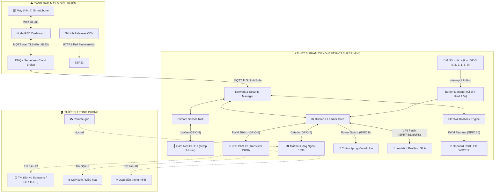

# Universal Smart IR Blaster & Climate Monitor (Zero-Brick FOTA Hub)

> **Đề xuất Đề tài Kết thúc Môn học / Báo cáo Giữa kỳ IoT**  
> **Sinh viên thực hiện:** Nguyễn Hoàng Đức ([Nhdnguyenhoangduc](https://github.com/Nhdnguyenhoangduc))  
> **Giảng viên hướng dẫn:** Thầy Tuấn Nguyễn  
> **Nền tảng phát triển:** ESP32-C3 Super Mini / PlatformIO / EMQX MQTT (TLS) / Node-RED Dashboard  
> **Repository GitHub:** [https://github.com/Nhdnguyenhoangduc/IOT_Smart_Remote](https://github.com/Nhdnguyenhoangduc/IOT_Smart_Remote)

---

## 📌 1. Đặt Bài Toán & Nhu Cầu Thực Tế (Motivation & Problem Statement)

Trong cuộc sống hiện đại và xu hướng nhà thông minh (Smart Home):
1. **Phân mảnh thiết bị điều khiển:** Mỗi gia đình thường sở hữu từ 4 đến 8 remote hồng ngoại riêng biệt (TV, điều hòa, quạt cây, đầu thu TV Box, loa thanh Soundbar...). Việc thất lạc remote, hết pin đột ngột hoặc bàn trà bừa bộn là phiền toái xảy ra hàng ngày.
2. **Thiết bị gia dụng cũ không có kết nối thông minh:** Hàng triệu thiết bị gia dụng (máy lạnh, quạt đời cũ) hoạt động rất tốt nhưng không thể điều khiển từ xa qua Internet hoặc hẹn giờ bật/tắt theo nhiệt độ phòng.
3. **Bài toán cập nhật Firmware từ xa an toàn (Zero-Brick FOTA):** Đa số các dự án IoT DIY tự chế khi triển khai thực tế rất dễ bị "treo vĩnh viễn" (biến thành cục gạch) nếu quá trình cập nhật OTA qua mạng bị mất điện, rớt mạng hoặc nạp nhầm mã lỗi.

👉 **Mục tiêu của đề tài:** Xây dựng một **Thiết bị điều khiển Hồng ngoại thông minh đa năng 2 chiều (Hybrid Dual-Control)**:
* Vừa là chiếc **Remote cầm tay tiện dụng** với 6 phím cứng vật lý và khả năng tự **học lệnh từ bất kỳ remote gốc** nào mà không cần máy tính.
* Vừa là một **IoT Gateway kết nối đám mây (EMQX MQTT)** tích hợp cảm biến nhiệt độ & độ ẩm DHT11.
* Cho phép **giám sát môi trường và điều khiển thiết bị qua Internet** trên điện thoại/máy tính bằng **Node-RED Dashboard**.
* Tích hợp kiến trúc **Secure HTTPS Pull FOTA với cơ chế tự động Rollback (Anti-Brick)** và chỉ báo trực quan bằng **LED RGB chuẩn sinh lý mắt người (Định luật Fechner)**.

---

## 💡 2. Điểm Sáng Tạo & Độc Đáo Của Đề Tài (Innovation & Creativity)

So với các mạch hồng ngoại Tuya/Broadlink thương mại hoặc đồ án IoT thông thường, đề tài sở hữu 4 điểm đột phá kỹ thuật:

1. **Điều khiển lai 2 chiều (Hybrid Dual-Control):**
   * Hoạt động độc lập bằng **6 phím cứng vật lý** trên tay: hỗ trợ 4 Profile thiết bị (TV, Điều hòa, Quạt, Thiết bị khác) với bộ nhớ Flash (LittleFS) lưu trữ cả mã giải mã và **xung thô RAW lên tới 700 mẫu** (bắt trọn tín hiệu phức tạp của các dòng máy lạnh Daikin, Panasonic, Mitsubishi).
   * Đồng thời kết nối **MQTT Broker qua mã hóa bảo mật TLS (Port 8883)** cho phép điều khiển từ xa không độ trễ.
2. **Cơ chế FOTA Chống Biến Thành Cục Gạch (Zero-Brick Rollback Architecture):**
   * Sử dụng bảng phân vùng 2 Slot OTA (`app0`, `app1`).
   * Bắt buộc kiểm tra mã băm **SHA256 (64-bit Hex)** trước khi ghi phân vùng khởi động.
   * Kích hoạt bộ đếm thời gian an toàn 180 giây: nếu firmware mới nạp vào bị lỗi mạng, crash hoặc không kết nối được broker, ESP32 sẽ **tự động hoàn nguyên (Rollback) về firmware cũ** an toàn.
3. **Chỉ báo trực quan LED RGB theo Định luật Weber-Fechner:**
   * Mắt người cảm nhận độ sáng ánh sáng theo hàm phi tuyến $S \propto \ln(L)$. Dự án áp dụng công thức nắn đường cong thị giác $\text{PWM} = 254 \times (\text{Percent}/100)^{2.4} + 1$.
   * Nhờ đó, tiến độ tải firmware (0% ➔ 100%) hiển thị tăng sáng mịn màng, tuyến tính tuyệt đối trước mắt người nhìn.
4. **Hạ tầng MQTT & Node-RED Dashboard Đầy Đủ:**
   * Giao diện Web App tương thích mọi kích thước màn hình (Smartphone, Tablet, PC).
   * Cho phép cấu hình trực tiếp Version, link tải GitHub Release và mã SHA256 ngay trên giao diện Web UI.

---

## 🏗️ 3. Sơ Đồ Khối Hệ Thống (System Architecture & Block Diagram)



---

## 🔌 4. Phần Cứng Dự Kiến & Sơ Đồ Kết Nối Chi Tiết

### Bảng linh kiện thực tế:
* **Vi điều khiển trung tâm:** Mạch ESP32-C3 Super Mini (RISC-V 160MHz, 4MB Flash, Wi-Fi 4 + BLE 5).
* **Bộ phát hồng ngoại:** LED phát hồng ngoại 940nm + Transistor NPN C828 lái dòng + Điện trở đệm 1kΩ.
* **Bộ thu hồng ngoại:** Mắt nhận tín hiệu IR 1838 (38kHz) tích hợp lọc quang học.
* **Cảm biến môi trường:** Cảm biến nhiệt độ & độ ẩm DHT11.
* **Bộ nút bấm điều khiển:** 6 nút nhấn cơ học micro switch (N1, N2, N3, N4, ON/OFF, FUNC).
* **Đèn báo trạng thái:** LED RGB WS2812 tích hợp sẵn trên mạch (chân GPIO 10).

### Sơ đồ gán chân GPIO (ESP32-C3):

| Thiết bị / Module | Chân GPIO | Vai trò kỹ thuật |
|---|:---:|---|
| **Nút bấm N1** | `GPIO 4` | Nhấn nhanh: Phát Slot 0 \| Nhấn giữ 1.5s: Học lệnh Slot 0 |
| **Nút bấm N2** | `GPIO 3` | Nhấn nhanh: Phát Slot 1 \| Nhấn giữ 1.5s: Học lệnh Slot 1 |
| **Nút bấm N3** | `GPIO 2` | Nhấn nhanh: Phát Slot 2 \| Nhấn giữ 1.5s: Học lệnh Slot 2 |
| **Nút bấm N4** | `GPIO 1` | Nhấn nhanh: Phát Slot 3 \| Nhấn giữ 1.5s: Học lệnh Slot 3 |
| **Nút bấm ON/OFF** | `GPIO 5` | Nhấn nhanh: Phát Slot 4 \| Nhấn giữ 1.5s: Học lệnh Slot 4 |
| **Nút bấm FUNC** | `GPIO 0` | Nhấn nhanh: Đổi Profile (1 ➔ 4) \| Nhấn giữ 3s: Chế độ WiFi |
| **LED Phát IR (TX)** | `GPIO 6` | Xuất sóng mang điều chế 38kHz tới chân Base transistor |
| **Mắt thu IR (RX)** | `GPIO 7` | Đọc tín hiệu xung từ remote gốc |
| **Cấp nguồn mắt thu (RX_PWR)** | `GPIO 8` | Bật nguồn VCC cho mắt thu (chỉ bật khi học lệnh để tiết kiệm điện & chống nhiễu) |
| **LED RGB WS2812** | `GPIO 10` | Hiển thị trạng thái máy, profile và tiến độ OTA theo định luật Fechner |
| **Cảm biến DHT11** | `GPIO 9` | Giao tiếp 1-Wire đọc nhiệt độ và độ ẩm |

---

## 🖥️ 5. Giao Diện Giám Sát & Điều Khiển (Node-RED Dashboard)

Hệ sinh thái điều khiển được tổ chức khoa học với các thành phần:
1. **Khối FOTA & Trạng thái Hệ thống:**
   * Giám sát Realtime tình trạng sống còn của mạch (`online`, `offline`), chỉ số sóng WiFi RSSI, bộ nhớ RAM Heap trống.
   * Bộ 3 ô Text Input: cho phép người dùng nhập trực tiếp **Version mới**, **Đường link GitHub Releases**, và **Mã kiểm tra SHA256** kèm nút bấm kích hoạt nạp từ xa.
2. **Khối Giám Sát Môi Trường (Climate Station):**
   * 2 Đồng hồ đo (Radial Gauge) hiển thị trực quan mức nhiệt độ (°C) và độ ẩm (%).
   * Biểu đồ đường (Line Chart) lưu vết lịch sử nhiệt ẩm trong phòng giúp theo dõi sự thay đổi theo thời gian thực.
3. **Khối Điều Khiển Remote Trực Quan:**
   * 4 nút chuyển đổi nhanh Profile thiết bị (`TV`, `Điều hòa`, `Quạt`, `Thiết bị khác`).
   * 5 nút chức năng đồng bộ với remote thực tế (`N1`, `N2`, `N3`, `N4`, `ON/OFF`).
4. **Khối Học Mã Tự Động:**
   * Nút bấm kích hoạt mắt thu trong 10 giây.
   * Khung hiển thị tự động in chi tiết mã vừa bắt được: Protocol (`NEC`, `Sony`, `Samsung`...), mã Hex (`0xFFA25D`), số bit và chuỗi xung RAW.

---

## 📂 6. Cấu Trúc Mã Nguồn (Clean Architecture PlatformIO)

Dự án tuân theo tiêu chuẩn mã nguồn nhúng công nghiệp, tách biệt module độc lập:

```text
ir-blaster-fota/
├── platformio.ini              # Cấu hình PlatformIO, thư viện, flash 4MB, 2 slot OTA
├── nodered-flow.json           # File cấu hình toàn bộ Flow và UI Dashboard Node-RED
├── README.md                   # Báo cáo đề tài chi tiết
└── src/
    ├── config.h                # Định nghĩa chân GPIO, hằng số thời gian, cấu hình hệ thống
    ├── secrets.h.example       # Template cấu hình WiFi, MQTT TLS CA Cert
    ├── led_indicator.h/.cpp    # Điều khiển LED RGB WS2812 & Thuật toán thị giác Fechner
    ├── button_manager.h/.cpp   # Quản lý 6 nút bấm vật lý (chống rung, click, hold 1.5s/3s)
    ├── ir_blaster.h/.cpp       # Lõi phát, thu học mã và lưu trữ LittleFS (IRremoteESP8266)
    ├── dht_sensor.h/.cpp       # Đọc cảm biến nhiệt ẩm DHT11 & tính toán trung bình
    ├── network_manager.h/.cpp  # Quản lý WiFi, MQTT TLS (EMQX) & Bộ định tuyến lệnh
    ├── ota_manager.h/.cpp      # Nạp HTTPS FOTA, xác thực SHA256 & Tự động Rollback chống brick
    └── main.cpp                # Điểm khởi động tinh gọn điều phối toàn bộ hệ thống
```

---

## 📚 7. Tài Liệu Tham Khảo (References)

1. **IRremoteESP8266 Library:** Thư viện giải mã và phát tín hiệu hồng ngoại toàn diện cho ESP32/ESP8266 ([GitHub crankyoldgit/IRremoteESP8266](https://github.com/crankyoldgit/IRremoteESP8266)).
2. **Espressif Systems ESP-IDF OTA API:** Tài liệu chính thức về phân vùng và quy trình OTA Rollback an toàn ([Espressif Docs](https://docs.espressif.com/projects/esp-idf/en/latest/esp32c3/api-reference/system/ota.html)).
3. **Định luật Weber-Fechner & Stevens' Power Law:** Nghiên cứu về độ nhạy cảm nhận phi tuyến tính của mắt người với cường độ sáng (Sensory Magnitude vs. Stimulus Luminance).
4. **CIE 1931 Color & Lightness Formula:** Tiêu chuẩn chuyển đổi cảm nhận thị giác người sang tín hiệu PWM điều khiển LED.
5. **Hackaday IoT & Smart Remote Projects:** Nguồn cảm hứng các dự án Universal Remote tự chế và tối ưu hóa năng lượng ([Hackaday.com](https://hackaday.com/)).

---

## 🎯 8. Kế Hoạch Triển Khai Tiếp Theo (Milestones)

* [x] **Giai đoạn 1 (Đã hoàn thành):** Xây dựng hạ tầng nạp FOTA bảo mật qua MQTT TLS, thuật toán LED Fechner, chống brick Rollback.
* [x] **Giai đoạn 2 (Đã hoàn thành):** Tích hợp phát/học IR (mã hex + RAW), 6 nút cứng vật lý, cảm biến DHT11 và dựng hoàn chỉnh Node-RED Dashboard.
* [ ] **Giai đoạn 3 (Hoàn thiện cuối kỳ):**
  * Thiết kế vỏ hộp 3D cho thiết bị nhỏ gọn, thẩm mỹ.
  * Tích hợp kịch bản tự động hóa trên Node-RED: *Tự động bật quạt/điều hòa khi nhiệt độ phòng vượt ngưỡng 30°C*.
  * Viết bài chia sẻ dự án lên cộng đồng DIY / Hackaday.
