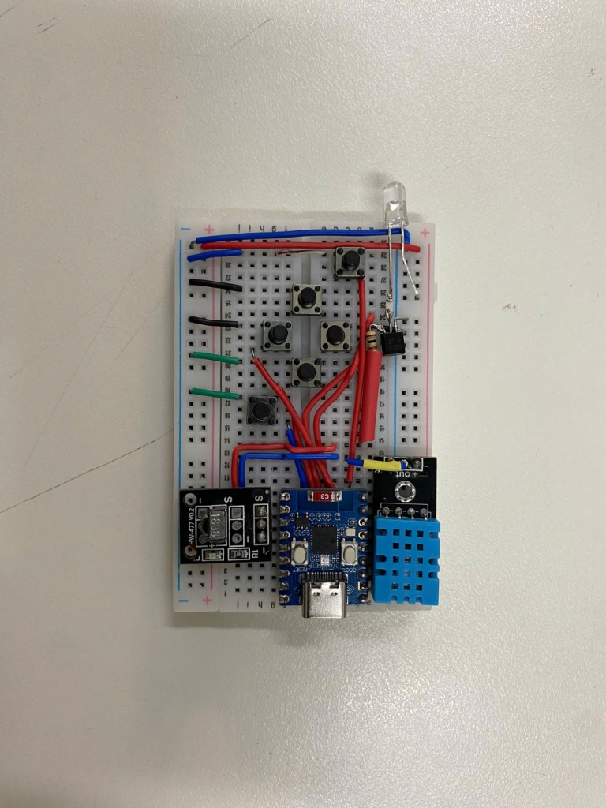
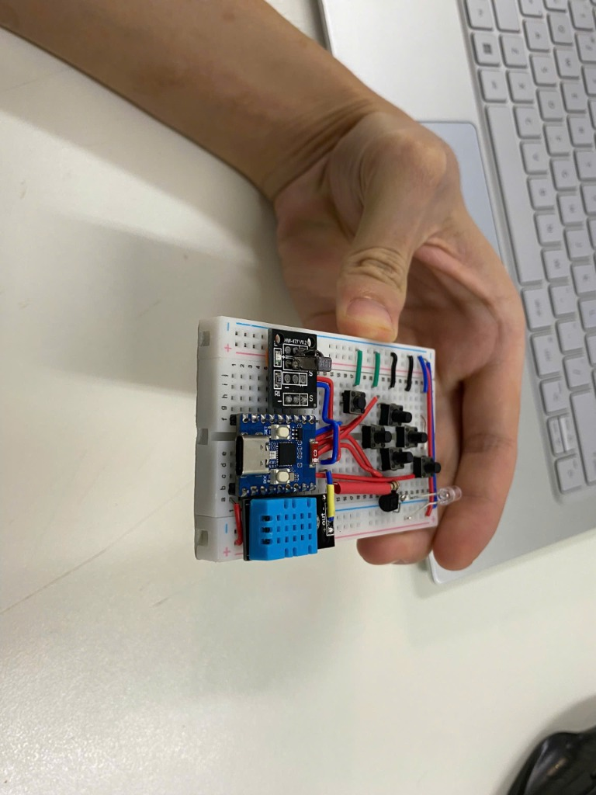
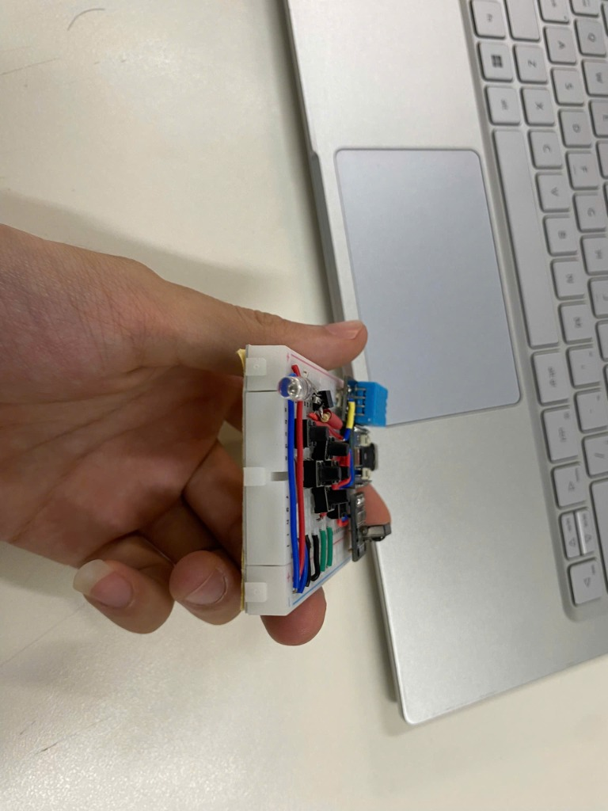
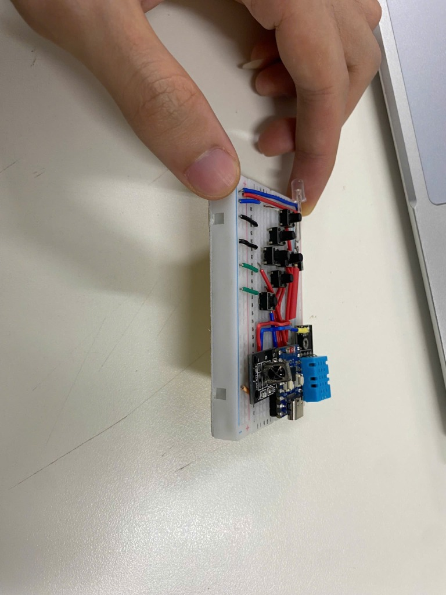
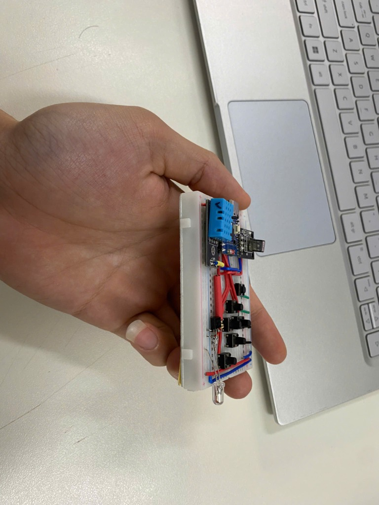
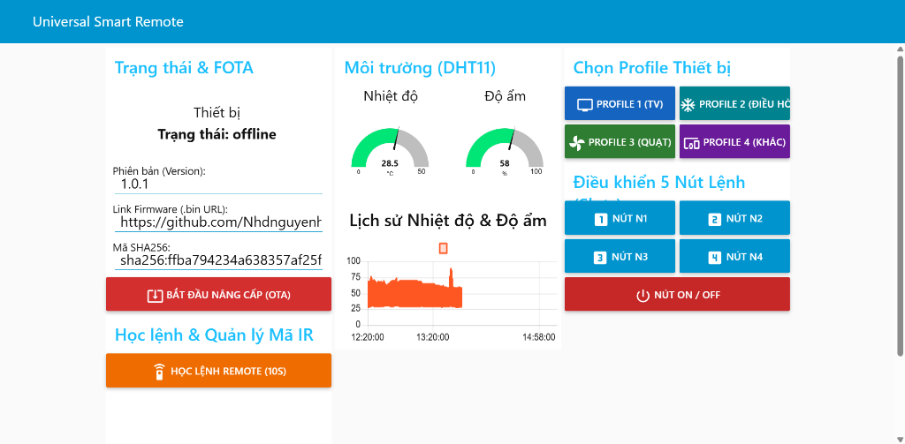

# Remote Hồng Ngoại Đa Năng và Giám Sát Môi Trường Hỗ Trợ FOTA

---

## 1. Thông Tin Đề Tài

* **Tên đề tài:** Remote Hồng Ngoại Đa Năng và Giám Sát Môi Trường Hỗ Trợ FOTA
* **Môn học:** Phát triển ứng dụng IOT
* **Sinh viên thực hiện:** Nguyễn Hoàng Đức ([@Nhdnguyenhoangduc](https://github.com/Nhdnguyenhoangduc))
* **Giảng viên môn học:** Nguyễn Anh Tuấn
* **Kho lưu trữ công khai (Public Repo):** [https://github.com/Nhdnguyenhoangduc/IOT_Smart_Remote](https://github.com/Nhdnguyenhoangduc/IOT_Smart_Remote)

---

## 2. Tổng Quan Dự Án

**Remote Hồng Ngoại Đa Năng và Giám Sát Môi Trường Hỗ Trợ FOTA** là thiết bị IoT biên (Edge Device) được phát triển trên vi điều khiển **ESP32-C3 Super Mini Zero**. Dự án giải quyết bài toán kết nối mạng cho các thiết bị điện gia dụng truyền thống (điều hòa không khí, tivi, quạt điện, máy âm thanh, mọi thiết bị sử dụng sóng hồng ngoại) vào hệ sinh thái nhà thông minh mà không cần thay mới phần cứng thiết bị gia dụng.

Hệ thống hoạt động đồng thời trên hai chế độ độc lập:
1. **Hoạt động như remote cầm tay độc lập (không cần mạng):** Thiết bị có sẵn 6 nút bấm vật lý, cho phép sao chép phím bấm từ bất kỳ remote nào trong nhà (Tivi, điều hòa, quạt...). Mã đã học được lưu vĩnh viễn vào bộ nhớ và không mất khi rút điện, giúp người dùng cầm bấm điều khiển ngay tại chỗ bình thường kể cả khi mất mạng Wi-Fi hoặc đứt cáp Internet.
2. **Cổng kết nối IoT đám mây:** Đồng bộ qua giao thức MQTT mã hóa TLS (Port 8883) về máy chủ EMQX Cloud. Toàn bộ thao tác giám sát nhiệt độ/độ ẩm từ cảm biến DHT11 và điều khiển thiết bị được quản lý trực quan qua giao diện Node-RED Dashboard trên máy tính và điện thoại thông minh.

Điểm nổi bật của dự án là tính năng **Cập nhật Firmware qua mạng (FOTA)** phục vụ công tác bảo trì, sửa lỗi và nâng cấp, bổ sung các bảng mã điều khiển thiết bị mới hoàn toàn từ xa mà không cần can thiệp phần cứng. Hệ thống tích hợp **cơ chế tự động nạp lại phần mềm cũ (Rollback)** giúp thiết bị không bao giờ bị treo ("biến thành cục gạch") khi quá trình cập nhật gặp sự cố:
* **Mất kết nối mạng hoặc Wi-Fi chập chờn** giữa chừng trong lúc đang tải firmware.
* **Mất nguồn điện đột ngột** (sụt áp, mất điện) trong quá trình nạp.
* **Tệp firmware bị lỗi hoặc bị hỏng** (sai lệch mã kiểm tra toàn vẹn SHA256).
* **Firmware mới bị crash, treo vòng lặp hoặc không kết nối được Wi-Fi/MQTT:** Sau khi nạp, thiết bị kích hoạt thời gian giám sát an toàn (180 giây); nếu firmware mới gặp lỗi không thể kết nối lại hệ thống, mạch sẽ tự động hủy bỏ và chuyển về chạy bản phần mềm cũ đang hoạt động ổn định trước đó.

---

## 3. Đặt Bài Toán & Nhu Cầu Thực Tế

### 3.1. Các vấn đề tồn tại trong thực tế:
1. **Phân mảnh thiết bị điều khiển trong gia đình:**  
   Mỗi phòng khách hoặc phòng ngủ thường có từ 4 đến 6 chiếc remote khác nhau (remote TV, điều hòa, quạt treo tường, đầu thu kỹ thuật số, loa soundbar...). Việc thất lạc remote, hết pin đột xuất là phiền toái xảy ra hàng ngày.
2. **Lãng phí khi loại bỏ thiết bị cũ:**  
   Hàng triệu máy lạnh và quạt điện thế hệ cũ vẫn hoạt động rất bền bỉ nhưng không có kết nối Wi-Fi. Việc vứt bỏ để mua thiết bị thông minh thế hệ mới gây tốn kém chi phí lớn cho người dùng và tạo ra lượng rác thải điện tử không cần thiết.
3. **Nguy cơ lỗi "biến thành cục gạch" khi nâng cấp từ xa:**  
   Các thiết bị IoT DIY hoặc giá rẻ khi nạp firmware qua Wi-Fi (OTA) nếu gặp sự cố chập chờn nguồn, rớt mạng giữa chừng hoặc file nạp bị lỗi cấu hình thường sẽ bị treo vĩnh viễn, buộc người dùng phải tháo vỏ dùng dây nạp cáp USB chuyên dụng để cứu hộ.

### 3.2. Mục tiêu giải pháp:
Xây dựng một giải pháp hoàn chỉnh với chi phí linh kiện thấp, kích thước nhỏ gọn bằng bao diêm, hoạt động tin cậy, điều khiển 2 chiều mượt mà và đảm bảo firmware luôn có thể tự phục hồi an toàn trong mọi tình huống triển khai thực tế.

---

## 4. Sơ Đồ Khối Hệ Thống (System Architecture)

---

## 5. Tính Năng Kỹ Thuật 

* **Điều khiển lai 2 chiều:** Có thể sử dụng như chiếc remote cầm tay độc lập qua 6 nút nhấn hoặc điều khiển qua mạng từ bảng điều khiển Node-RED Dashboard.
* **Bộ giải mã và phát xung hồng ngoại vạn năng:** Hỗ trợ giải mã các giao thức dân dụng phổ biến (NEC, Sony SIRC, Philips RC5/6, Samsung) và cơ chế bắt chuỗi xung thô (**RAW pulse train lên tới 700 mẫu xung**) dành cho các dòng máy lạnh phức tạp (Daikin, Panasonic, Mitsubishi, Gree).
* **Quản trị 4 Profile thiết bị đa năng:** Lưu trữ 4 profile độc lập (Profile 0: Tivi, Profile 1: Điều hòa, Profile 2: Quạt điện, Profile 3: Thiết bị khác). Mỗi profile quản lý 5 nút lệnh (Slot 0 đến Slot 4) lưu trực tiếp vào bộ nhớ flash LittleFS và có thể tăng số lượng Profile.
* **Cơ chế cấp nguồn thông minh cho mắt thu IR (Power Gating):** Mắt thu hồng ngoại 1838 chỉ được cấp nguồn qua chân GPIO 8 khi kích hoạt chế độ học lệnh (giới hạn thời gian chờ 10 giây). Điều này giúp triệt tiêu hiện tượng nhiễu quang học từ môi trường và tiết kiệm năng lượng.
* **Cơ chế Cập nhật FOTA Chống Biến Thành Cục Gạch:**
  * Tận dụng bảng phân vùng 2 slot OTA (`app0` và `app1`).
  * Tải firmware qua luồng mã hóa HTTPS và tính toán băm SHA256 từng khối dữ liệu trong khi nạp.
  * Chỉ khi mã SHA256 khớp tuyệt đối với tham số chỉ định thì thiết bị mới hoán đổi phân vùng khởi động.
  * Kích hoạt bộ đếm thời gian an toàn 180 giây sau khởi động: nếu firmware mới bị lỗi crash, tràn bộ nhớ hoặc mất kết nối mạng, bootloader sẽ **tự động hoàn nguyên (Rollback) về bản firmware cũ ổn định trước đó**.

---

## 6. Danh Mục Phần Cứng & Sơ Đồ Đấu Nối GPIO

### 6.1. Bảng linh kiện phần cứng thật:

| Tên linh kiện | Thông số kỹ thuật | Số lượng | Vai trò trong hệ thống |
|:---|:---|:---:|:---|
| **Mạch ESP32-C3 Super Mini Zero** | Vi xử lý RISC-V 32-bit 160MHz, 4MB Flash, Wi-Fi 2.4GHz + BLE | 1 mạch | Khối điều khiển trung tâm và xử lý mạng |
| **LED phát hồng ngoại 940nm** | Bước sóng 940nm, góc phát rộng | 1 chiếc | Phát tín hiệu điều khiển thiết bị |
| **Transistor NPN C828 + Trở 1kΩ** | Transistor chuyển mạch khuếch đại dòng | 1 bộ | Mạch đệm dòng lái LED phát IR đạt cự ly xa |
| **Mắt thu hồng ngoại VS1838B** | Tần số sóng mang 38kHz, tích hợp mạch lọc giải điều chế | 1 chiếc | Nhận và học tín hiệu từ remote gốc |
| **Cảm biến nhiệt độ & độ ẩm DHT11** | Dải nhiệt 0-50°C, dải ẩm 20-90% RH | 1 chiếc | Giám sát môi trường phòng theo thời gian thực |
| **Đèn LED RGB WS2812** | LED kỹ thuật số tích hợp sẵn trên bo mạch | 1 chiếc | Hiển thị trạng thái hoạt động và tiến độ FOTA |
| **Nút bấm cơ học (Tactile Switch)** | Nút nhấn nhả micro switch loại 4 chân/2 chân | 6 chiếc | Cụm nút bấm vật lý điều khiển và học lệnh |

### 6.2. Bảng phân bổ chân GPIO trên ESP32-C3:

| Tên thiết bị / Chân nối | Chân GPIO | Chế độ cấu hình | Ý nghĩa chức năng |
|:---|:---:|:---:|:---|
| **LED Phát Hồng Ngoại** | `GPIO 6` | OUTPUT (PWM 38kHz) | Bắn tín hiệu điều khiển ra không gian |
| **Mắt Nhận Hồng Ngoại (Data)** | `GPIO 7` | INPUT | Đọc xung tín hiệu từ remote cần học |
| **Khóa Nguồn Mắt Nhận IR** | `GPIO 8` | OUTPUT | Bật nguồn (HIGH) khi học lệnh, tắt (LOW) để chống nhiễu |
| **Cảm biến Môi trường DHT11** | `GPIO 9` | INPUT_PULLUP (1-Wire) | Giao tiếp lấy dữ liệu nhiệt độ và độ ẩm |
| **LED RGB WS2812 Onboard** | `GPIO 10` | OUTPUT (Single-Wire) | Chỉ báo trực quan trạng thái và tiến độ OTA |
| **Nút Bấm N1** | `GPIO 4` | INPUT_PULLUP | Nhấn nhanh: Phát Slot 0 \| Nhấn giữ 1.5s: Học lệnh Slot 0 |
| **Nút Bấm N2** | `GPIO 3` | INPUT_PULLUP | Nhấn nhanh: Phát Slot 1 \| Nhấn giữ 1.5s: Học lệnh Slot 1 |
| **Nút Bấm N3** | `GPIO 2` | INPUT_PULLUP | Nhấn nhanh: Phát Slot 2 \| Nhấn giữ 1.5s: Học lệnh Slot 2 |
| **Nút Bấm N4** | `GPIO 1` | INPUT_PULLUP | Nhấn nhanh: Phát Slot 3 \| Nhấn giữ 1.5s: Học lệnh Slot 3 |
| **Nút Bấm ON/OFF** | `GPIO 5` | INPUT_PULLUP | Nhấn nhanh: Bật/Tắt nguồn thiết bị (Slot 4) |
| **Nút Bấm FUNC** | `GPIO 0` | INPUT_PULLUP | Chuyển đổi tuần tự Profile thiết bị (0 ➔ 1 ➔ 2 ➔ 3) |

### 6.3. Hình ảnh Phần Cứng Thực Tế

#### Góc nhìn tổng thể mặt trên (Top-down View):
Bao gồm vi điều khiển ESP32-C3 Super Mini Zero, cảm biến nhiệt độ & độ ẩm DHT11, mắt thu hồng ngoại VS1838B, transistor C828 lái LED phát IR và cụm 6 nút bấm vật lý:

  

#### Các góc nhìn chi tiết và kích thước thực tế trên tay:

| Cầm trên tay thực tế (Góc nghiêng) | Cạnh LED phát hồng ngoại 940nm |
|:---:|:---:|
|  |  |
| **Cạnh cổng USB-C & Mắt thu VS1838B** | **Cạnh cảm biến môi trường DHT11** |
|  |  |

---

## 7. Giao Diện Bảng Điều Khiển (Node-RED Dashboard)

Bảng điều khiển trực quan trên nền tảng Web (tương thích máy tính, máy tính bảng và điện thoại thông minh), giao tiếp thời gian thực 2 chiều với thiết bị qua MQTT TLS:

  

* **Khối Trạng thái & Nâng cấp FOTA:** Theo dõi trạng thái hoạt động của thiết bị (`online`/`offline`), hỗ trợ nhập trực tiếp thông tin phiên bản (Version), đường dẫn tải firmware (`.bin URL`) và mã kiểm tra SHA256 kèm nút kích hoạt nạp phần mềm từ xa an toàn.
* **Khối Môi trường (DHT11):** Hiển thị trực quan thông số Nhiệt độ (°C) và Độ ẩm (%) bằng đồng hồ đo (Gauge), kết hợp biểu đồ theo dõi lịch sử biến thiên nhiệt độ phòng theo thời gian thực.
* **Khối Chọn Profile Thiết bị:** Chuyển đổi linh hoạt giữa 4 nhóm thiết bị (Profile 1: Tivi, Profile 2: Điều hòa, Profile 3: Quạt điện, Profile 4: Khác).
* **Khối Điều khiển & Học lệnh IR:** Cung cấp cụm 5 phím điều khiển từ xa (N1 – N4, Nút nguồn ON/OFF) và nút bấm kích hoạt mở cửa sổ 10 giây học mã trực tiếp từ remote gốc.

---

## 8. Công Nghệ Sử Dụng (Technology Stack)

* **Ngôn ngữ lập trình:** C++ (nền tảng Arduino / FreeRTOS).
* **Môi trường phát triển:** PlatformIO trên Visual Studio Code.
* **Giao thức truyền thông:** MQTT kết nối bảo mật qua TLS (cổng 8883).
* **Máy chủ MQTT Broker:** EMQX Cloud.
* **Giao diện điều khiển & giám sát:** Node-RED Dashboard (xem trên điện thoại, máy tính).
* **Xử lý tín hiệu hồng ngoại:** Thư viện IRremoteESP8266 (hỗ trợ giải mã và phát xung RAW).
* **Lưu trữ dữ liệu:** Bộ nhớ Flash nội tại (LittleFS).
* **Kiểm tra an toàn firmware:** Mã băm SHA-256 chống lỗi file nạp.

---

## 9. Bảng Thông Số Kỹ Thuật Dự Án

| Thông số | Giá trị thực tế đạt được | Ghi chú kỹ thuật |
|:---|:---|:---|
| **Tần số xung nhịp CPU** | 160 MHz | Vi xử lý 32-bit RISC-V Single-Core |
| **Mức chiếm dụng bộ nhớ RAM** | ~40 KB (khoảng 12.9% tổng dung lượng) | Bộ nhớ heap tự do luôn duy trì dồi dào |
| **Phân vùng bộ nhớ Flash** | 4MB Flash (`min_spiffs.csv`) | Gồm `app0` (1.9MB), `app1` (1.9MB), LittleFS (192KB) |
| **Tần số sóng mang phát IR** | 38 kHz (Chu kỳ xung 50% duty cycle) | Tương thích hầu hết các thiết bị điện dân dụng |
| **Cự ly điều khiển hồng ngoại** | 7 đến 10 mét | Góc chiếu thẳng trực diện qua thấu kính LED |
| **Dung lượng đệm xung RAW** | 700 mẫu thời gian xung | Thu nhận toàn vẹn các khung dữ liệu điều hòa đa byte |
| **Nguồn điện cấp hoạt động** | 5V DC (Cổng USB-C) / 3.3V System | Tích hợp IC ổn áp nguồn xung trên mạch Super Mini |
| **Độ trễ điều khiển qua Cloud** | Dưới 120 ms | Đo đạc qua kết nối Wi-Fi cáp quang tiêu chuẩn |

---

## 10. Khả Năng Ứng Dụng Thực Tế

* **Nâng cấp nhà thông minh chi phí thấp:** Biến các thiết bị điện tử gia dụng thế hệ cũ trong gia đình thành thiết bị thông minh kết nối mạng mà không cần thay thế thiết bị gốc.
* **Tự động hóa phòng khách và phòng ngủ:** Thiết lập kịch bản tự động bật điều hòa khi nhiệt độ môi trường vượt ngưỡng cài đặt trên Node-RED Dashboard.
* **Quản lý thiết bị tập trung trong trường học và cơ quan:** Cho phép quản trị viên điều khiển tắt mở máy chiếu, quạt trần và hệ thống điều hòa tại các phòng học từ xa, tránh tình trạng quên tắt thiết bị gây lãng phí điện năng.

---

## 11. Kế Hoạch & Lộ Trình Phát Triển Tương Lai

- [ ] **Mở rộng giao thức chuẩn Matter / Apple HomeKit:** Tích hợp tương thích trực tiếp với Home Assistant và Google Home qua chuẩn kết nối mới.
- [ ] **Tối ưu hóa chế độ ngủ sâu (Deep Sleep):** Ứng dụng cảm biến chuyển động PIR để đánh thức vi điều khiển từ trạng thái ngủ sâu, phục vụ mục tiêu chạy bằng pin sạc dung lượng nhỏ.
- [ ] **Cấu hình mạng không chạm (BLE Provisioning):** Bổ sung tính năng quét mã QR hoặc cấu hình Wi-Fi qua giao tiếp Bluetooth Low Energy tiện lợi.
- [ ] **Thiết kế vỏ hộp in 3D chuyên dụng:** Thiết kế vỏ bảo vệ thẩm mỹ cao tích hợp cụm phát hồng ngoại 360 độ góc rộng không góc chết.
