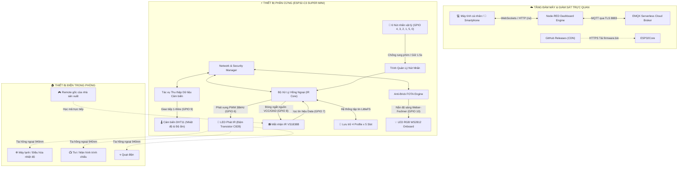

# Remote Hồng Ngoại Đa Năng và Giám Sát Môi Trường Hỗ Trợ FOTA
*(Universal Smart IR Remote & Climate Monitor with Zero-Brick FOTA)*

[](https://www.espressif.com/)
[](https://platformio.org/)
[](https://www.emqx.com/)
[](https://nodered.org/)
[](#14-bản-quyền-và-chính-sách-mã-nguồn)

---

## 1. Thông Tin Đề Tài

* **Tên đề tài:** Remote Hồng Ngoại Đa Năng và Giám Sát Môi Trường Hỗ Trợ FOTA
* **Môn học:** Phát triển ứng dụng IOT — Báo cáo & Đề xuất Đề tài Giữa kỳ (Thang điểm 20)
* **Sinh viên thực hiện:** Nguyễn Hoàng Đức ([@Nhdnguyenhoangduc](https://github.com/Nhdnguyenhoangduc))
* **Giảng viên môn học:** Tiến Sĩ Nguyễn Anh Tuấn
* **Kho lưu trữ công khai (Public Repo):** [https://github.com/Nhdnguyenhoangduc/IOT_Smart_Remote](https://github.com/Nhdnguyenhoangduc/IOT_Smart_Remote)

---

## 2. Tổng Quan Dự Án

**Universal Smart IR Blaster & Climate Monitor** là thiết bị IoT biên (Edge Device) được phát triển trên vi điều khiển **ESP32-C3 Super Mini Zero**. Dự án giải quyết bài toán kết nối mạng cho các thiết bị điện gia dụng truyền thống (điều hòa không khí, tivi, quạt điện, máy âm thanh, mọi thiết bị sử dụng sóng hồng ngoại) vào hệ sinh thái nhà thông minh mà không cần thay mới phần cứng thiết bị gia dụng.

Hệ thống hoạt động đồng thời trên hai chế độ độc lập:
1. **Remote cầm tay vật lý (Offline Mode):** Trang bị 6 nút bấm cơ học, cho phép học lệnh trực tiếp từ remote gốc và lưu trữ vĩnh viễn vào bộ nhớ Flash. Người dùng có thể cầm bấm điều khiển ngay tại chỗ mà không phụ thuộc vào kết nối Internet.
2. **Cổng kết nối IoT đám mây:** Đồng bộ qua giao thức MQTT mã hóa TLS (Port 8883) về máy chủ EMQX Cloud. Toàn bộ thao tác giám sát nhiệt độ/độ ẩm từ cảm biến DHT11 và điều khiển thiết bị được quản lý trực quan qua giao diện Node-RED Dashboard trên máy tính và điện thoại thông minh.

Điểm đột phá của dự án là cơ chế **Cập nhật Firmware qua mạng an toàn (Zero-Brick FOTA)** kết hợp kiểm tra toàn vẹn băm mật mã SHA256, tự động hoàn nguyên (Rollback) khi gặp sự cố, và hiệu ứng chỉ báo trạng thái LED RGB được nắn theo **Định luật sinh lý thị giác Weber-Fechner**.

---

## 3. Đặt Bài Toán & Nhu Cầu Thực Tế

### 3.1. Các vấn đề tồn tại trong thực tế:
1. **Phân mảnh thiết bị điều khiển trong gia đình:**  
   Mỗi phòng khách hoặc phòng ngủ thường có từ 4 đến 6 chiếc remote khác nhau (remote TV, điều hòa, quạt treo tường, đầu thu kỹ thuật số, loa soundbar...). Việc thất lạc remote, hết pin đột xuất và bừa bộn bàn trà là phiền toái xảy ra hàng ngày.
2. **Lãng phí khi loại bỏ thiết bị cũ:**  
   Hàng triệu máy lạnh và quạt điện thế hệ cũ vẫn hoạt động rất bền bỉ nhưng không có kết nối Wi-Fi. Việc vứt bỏ để mua thiết bị thông minh thế hệ mới gây tốn kém chi phí lớn cho người dùng và tạo ra lượng rác thải điện tử không cần thiết.
3. **Nguy cơ lỗi "biến thành cục gạch" (Bricking) khi nâng cấp từ xa:**  
   Các thiết bị IoT DIY hoặc giá rẻ khi nạp firmware qua Wi-Fi (OTA) nếu gặp sự cố chập chờn nguồn, rớt mạng giữa chừng hoặc file nạp bị lỗi cấu hình thường sẽ bị treo vĩnh viễn (brick), buộc người dùng phải tháo vỏ dùng dây nạp cáp USB chuyên dụng để cứu hộ.

### 3.2. Mục tiêu giải pháp:
Xây dựng một giải pháp hoàn chỉnh với chi phí linh kiện thấp, kích thước nhỏ gọn bằng bao diêm, hoạt động tin cậy, điều khiển 2 chiều mượt mà và đảm bảo firmware luôn có thể tự phục hồi an toàn trong mọi tình huống triển khai thực tế.

---

## 4. Sơ Đồ Khối Hệ Thống (System Architecture)



---

## 5. Tính Năng Kỹ Thuật Đột Phá

* **Điều khiển lai 2 chiều (Hybrid Dual-Control):** Có thể sử dụng như chiếc remote cầm tay độc lập qua 6 nút nhấn hoặc điều khiển qua mạng từ bảng điều khiển Node-RED Dashboard.
* **Bộ giải mã và phát xung hồng ngoại vạn năng:** Hỗ trợ giải mã các giao thức dân dụng phổ biến (NEC, Sony SIRC, Philips RC5/6, Samsung) và cơ chế bắt chuỗi xung thô (**RAW pulse train lên tới 700 mẫu xung**) dành cho các dòng máy lạnh phức tạp (Daikin, Panasonic, Mitsubishi, Gree).
* **Quản trị 4 Profile thiết bị đa năng:** Lưu trữ 4 profile độc lập (Profile 0: Tivi, Profile 1: Điều hòa, Profile 2: Quạt điện, Profile 3: Thiết bị khác). Mỗi profile quản lý 5 nút lệnh (Slot 0 đến Slot 4) lưu trực tiếp vào bộ nhớ flash LittleFS.
* **Cơ chế cấp nguồn thông minh cho mắt thu IR (Power Gating):** Mắt thu hồng ngoại 1838 chỉ được cấp nguồn qua chân GPIO 8 khi kích hoạt chế độ học lệnh (giới hạn thời gian chờ 10 giây). Điều này giúp triệt tiêu hiện tượng nhiễu quang học từ môi trường và tiết kiệm năng lượng.
* **Cơ chế Cập nhật FOTA Chống Biến Thành Cục Gạch (Zero-Brick Rollback):**
  * Tận dụng bảng phân vùng 2 slot OTA (`app0` và `app1`).
  * Tải firmware qua luồng mã hóa HTTPS và tính toán băm SHA256 từng khối dữ liệu trong khi nạp.
  * Chỉ khi mã SHA256 khớp tuyệt đối với tham số chỉ định thì thiết bị mới hoán đổi phân vùng khởi động.
  * Kích hoạt bộ đếm thời gian an toàn 180 giây sau khởi động: nếu firmware mới bị lỗi crash, tràn bộ nhớ hoặc mất kết nối mạng, bootloader sẽ **tự động hoàn nguyên (Rollback) về bản firmware cũ ổn định trước đó**.
* **Chỉ báo trực quan LED RGB chuẩn sinh lý thị giác Weber-Fechner:**
  * Cảm nhận độ sáng của mắt người đối với ánh sáng tuân theo quy luật phi tuyến $S = k \cdot \ln(I)$.
  * Dự án áp dụng công thức nắn mức độ sáng thực nghiệm: $\text{PWM} = 254 \times (\text{Percent} / 100)^{2.4} + 1$.
  * Nhờ đó, hiệu ứng LED RGB khi tải tiến độ OTA (0% đến 100%) hoặc nhịp thở trạng thái đạt độ chuyển tiếp tăng sáng cực kỳ mượt mà.

---

## 6. Danh Mục Phần Cứng & Sơ Đồ Đấu Nối GPIO

### 6.1. Bảng linh kiện phần cứng thật:

| Tên linh kiện | Thông số kỹ thuật | Số lượng | Vai trò trong hệ thống |
|:---|:---|:---:|:---|
| **Mạch ESP32-C3 Super Mini** | Vi xử lý RISC-V 32-bit 160MHz, 4MB Flash, Wi-Fi 2.4GHz + BLE | 1 mạch | Khối điều khiển trung tâm và xử lý mạng |
| **LED phát hồng ngoại 940nm** | Bước sóng 940nm, góc phát rộng | 1 chiếc | Phát tín hiệu điều khiển thiết bị |
| **Transistor NPN C828 + Trở 1kΩ** | Transistor chuyển mạch khuếch đại dòng | 1 bộ | Mạch đệm dòng lái LED phát IR đạt cự ly xa |
| **Mắt thu hồng ngoại VS1838B** | Tần số sóng mang 38kHz, tích hợp mạch lọc giải điều chế | 1 chiếc | Nhận và học tín hiệu từ remote gốc |
| **Cảm biến nhiệt độ & độ ẩm DHT11** | Dải nhiệt 0-50°C, dải ẩm 20-90% RH | 1 chiếc | Giám sát môi trường phòng theo thời gian thực |
| **Đèn LED RGB WS2812** | LED kỹ thuật số tích hợp sẵn trên bo mạch | 1 chiếc | Hiển thị trạng thái hoạt động và tiến độ FOTA |
| **Nút bấm cơ học (Tactile Switch)** | Nút nhấn nhả micro switch loại 4 chân/2 chân | 6 chiếc | Cụm nút bấm vật lý điều khiển và học lệnh |

### 6.2. Bảng phân bổ chân GPIO trên ESP32-C3:

| Tên thiết bị / Chân nối | Chân GPIO | Chế độ cấu hình | Ý nghĩa chức năng |
|:---|:---:|:---:|:---|
| **LED Phát Hồng Ngoại** | `GPIO 6` | OUTPUT (PWM 38kHz) | Bắn tín hiệu điều khiển ra không gian |
| **Mắt Nhận Hồng Ngoại (Data)** | `GPIO 7` | INPUT | Đọc xung tín hiệu từ remote cần học |
| **Khóa Nguồn Mắt Nhận IR** | `GPIO 8` | OUTPUT | Bật nguồn (HIGH) khi học lệnh, tắt (LOW) để chống nhiễu |
| **Cảm biến Môi trường DHT11** | `GPIO 9` | INPUT_PULLUP (1-Wire) | Giao tiếp lấy dữ liệu nhiệt độ và độ ẩm |
| **LED RGB WS2812 Onboard** | `GPIO 10` | OUTPUT (Single-Wire) | Chỉ báo trực quan trạng thái và tiến độ OTA |
| **Nút Bấm N1** | `GPIO 4` | INPUT_PULLUP | Nhấn nhanh: Phát Slot 0 \| Nhấn giữ 1.5s: Học lệnh Slot 0 |
| **Nút Bấm N2** | `GPIO 3` | INPUT_PULLUP | Nhấn nhanh: Phát Slot 1 \| Nhấn giữ 1.5s: Học lệnh Slot 1 |
| **Nút Bấm N3** | `GPIO 2` | INPUT_PULLUP | Nhấn nhanh: Phát Slot 2 \| Nhấn giữ 1.5s: Học lệnh Slot 2 |
| **Nút Bấm N4** | `GPIO 1` | INPUT_PULLUP | Nhấn nhanh: Phát Slot 3 \| Nhấn giữ 1.5s: Học lệnh Slot 3 |
| **Nút Bấm ON/OFF** | `GPIO 5` | INPUT_PULLUP | Nhấn nhanh: Bật/Tắt nguồn thiết bị (Slot 4) |
| **Nút Bấm FUNC** | `GPIO 0` | INPUT_PULLUP | Chuyển đổi tuần tự Profile thiết bị (0 ➔ 1 ➔ 2 ➔ 3) |

---

## 7. Ngăn Xếp Công Nghệ (Technology Stack)

* **Ngôn ngữ lập trình:** C++ chuẩn cho hệ thống nhúng (ESP32 Arduino Core 3.x trên nền tảng FreeRTOS).
* **Môi trường phát triển:** PlatformIO Core trên Visual Studio Code.
* **Giao thức truyền thông:** MQTT Client (`PubSubClient`) kết hợp với `WiFiClientSecure` (Mã hóa SSL/TLS 1.2/1.3).
* **Mã hóa xác thực:** Tăng tốc phần cứng MbedTLS SHA-256.
* **Lưu trữ dữ liệu:** LittleFS Virtual File System trên phân vùng Flash nội tại.
* **Xử lý tín hiệu IR:** Thư viện mã nguồn mở `IRremoteESP8266` tối ưu cho lõi vi xử lý RISC-V ESP32-C3.
* **Máy chủ môi giới tin nhắn:** EMQX Serverless Cloud Broker (Cổng bảo mật `8883` MQTTS).
* **Giao diện điều khiển & Giám sát:** Node-RED Engine và Node-RED Dashboard (`node-red-dashboard`).

---

## 8. Kiến Trúc Truyền Thông & Danh Mục MQTT Topics

### 8.1. Thông số kết nối Cloud Broker:
* **Địa chỉ Broker:** `xxxx.emqxsl.com` (EMQX Serverless Cloud)
* **Cổng dịch vụ:** `8883` (Bảo mật TLS có mã hóa)
* **Định danh Client ID:** Tự động tạo theo định dạng `irb-<MAC_ADDRESS>` duy nhất cho từng bo mạch.

### 8.2. Danh mục Topic định tuyến:

| MQTT Topic | Chiều truyền | Mức QoS | Chức năng chi tiết |
|:---|:---:|:---:|:---|
| `ir/<DEVICE_ID>/status` | Thiết bị ➔ Cloud | 1 | Gửi nhịp tim định kỳ, thông số Wi-Fi, bộ nhớ RAM và trạng thái OTA |
| `ir/<DEVICE_ID>/dht` | Thiết bị ➔ Cloud | 1 | Gửi kết quả đo đạc chu kỳ từ cảm biến nhiệt độ & độ ẩm |
| `ir/<DEVICE_ID>/learned` | Thiết bị ➔ Cloud | 1 | Báo cáo chi tiết mã lệnh (Giao thức, Hex Code, Bits, Mảng RAW) vừa học |
| `ir/<DEVICE_ID>/cmd/ir/slot` | Cloud ➔ Thiết bị | 1 | Lệnh kích hoạt phát xung lệnh từ xa theo chỉ mục Slot (0 đến 4) |
| `ir/<DEVICE_ID>/cmd/ir/profile` | Cloud ➔ Thiết bị | 1 | Lệnh thay đổi Profile thiết bị đang chọn (0 đến 3) |
| `ir/<DEVICE_ID>/cmd/ir/learn` | Cloud ➔ Thiết bị | 1 | Lệnh yêu cầu thiết bị mở cửa sổ nhận mã học lệnh từ xa |
| `ir/<DEVICE_ID>/cmd/ota` | Cloud ➔ Thiết bị | 1 | Lệnh kích hoạt nâng cấp Firmware từ xa qua HTTPS |

### 8.3. Mẫu dữ liệu gói tin (Payload Examples):

* **Nhịp tim trạng thái (`ir/<DEVICE_ID>/status`):**
```json
{
  "state": "online",
  "fw": "1.0.3",
  "rssi": -51,
  "heap": 117144,
  "info": "ready"
}
```

* **Dữ liệu nhiệt độ môi trường (`ir/<DEVICE_ID>/dht`):**
```json
{
  "temp": 28.5,
  "hum": 65.0
}
```

* **Lệnh kích hoạt nạp Firmware OTA (`ir/<DEVICE_ID>/cmd/ota`):**
```json
{
  "version": "1.0.3",
  "url": "https://github.com/Nhdnguyenhoangduc/IOT_Smart_Remote/releases/download/v1.0.3/firmware.bin",
  "sha256": "48ddcda1d7bb11515f24e3d943512e41818968f64b0c1df7d15c7da778b1f48a"
}
```

---

## 9. Lưu Đồ Hoạt Động & Quy Trình Xử Lý Hệ Thống

### 9.1. Quy trình Cập nhật FOTA Chống Lỗi (Zero-Brick Rollback Sequence):

```mermaid
sequenceDiagram
    autonumber
    actor NguoiDung as Người Vận Hành (Node-RED)
    participant Broker as EMQX Cloud Broker (TLS)
    participant ThietBi as Bo Mạch ESP32-C3
    participant GitHubCDN as Máy Chủ GitHub Releases
    participant Bootloader as 2-Slot OTA Bootloader

    NguoiDung->>Broker: Gửi lệnh nâng cấp OTA (Version, URL, SHA256)
    Broker->>ThietBi: Chuyển phát lệnh đến topic `ir/+/cmd/ota`
    ThietBi->>ThietBi: So sánh Version đích với FW_VERSION hiện tại
    ThietBi->>GitHubCDN: Mở luồng kết nối HTTPS tải file firmware.bin
    loop Đọc và ghi dữ liệu từng khối (Chunk by chunk)
        ThietBi->>ThietBi: Ghi khối dữ liệu vào phân vùng OTA trống (app1)
        ThietBi->>ThietBi: Tính toán băm SHA256 lũy tích và cập nhật LED Fechner
        ThietBi->>Broker: Báo cáo trạng thái (`state: ota_progress`, `info: X%`)
    end
    ThietBi->>ThietBi: Kiểm tra đối chiếu mã SHA256 tính toán với mã được giao
    alt Mã SHA256 khớp tuyệt đối
        ThietBi->>Bootloader: Thiết lập phân vùng khởi động tiếp theo sang `app1`
        ThietBi->>ThietBi: Đóng kết nối mạng an toàn và khởi động lại
        ThietBi->>ThietBi: Nạp firmware mới; Kích hoạt bộ đếm kiểm định 180 giây
        ThietBi->>Broker: Đăng nhập mạng thành công và gửi thông điệp `online`
        ThietBi->>Bootloader: Đánh dấu phân vùng hoạt động hợp lệ (`markValid`)
    else Mã SHA256 không khớp hoặc mất điện/rớt mạng giữa chừng
        ThietBi->>ThietBi: Hủy bỏ tiến trình ghi và loại bỏ phân vùng lỗi
        ThietBi->>Broker: Báo cáo sự cố `state: ota_failed`
        ThietBi->>Bootloader: Tự động khởi động lại bằng phân vùng cũ an toàn
    end
```

### 9.2. Quy trình Học lệnh Hồng ngoại tại chỗ (Local IR Learning):
1. Người dùng ấn giữ một trong các nút lệnh (`N1` đến `N4`) trong 1.5 giây hoặc bấm nút *HỌC LỆNH* trên giao diện Node-RED.
2. Đèn LED RGB chuyển sang màu vàng cam và chân GPIO 8 cấp điện cho mắt thu VS1838B.
3. Người dùng chĩa remote gốc vào mắt thu và nhấn nút cần sao chép.
4. Mạch bắt tín hiệu: nếu là mã chuẩn (NEC, Sony, RC5...) mạch sẽ trích xuất mã Hex; nếu là mã điều hòa dạng xung dài, mạch sẽ thu trọn mảng độ rộng xung thô RAW (tối đa 700 phần tử).
5. Dữ liệu được ghi thẳng vào tệp tin trên bộ nhớ Flash (`/p<profile>_s<slot>.dat`).
6. Chân GPIO 8 ngắt nguồn mắt thu, đèn LED chớp xanh lá xác nhận học lệnh thành công.

---

## 10. Bảng Thông Số Kỹ Thuật Dự Án (Specifications)

| Thông số | Giá trị thực tế đạt được | Ghi chú kỹ thuật |
|:---|:---|:---|
| **Tần số xung nhịp CPU** | 160 MHz | Vi xử lý 32-bit RISC-V Single-Core |
| **Mức chiếm dụng bộ nhớ RAM** | ~40 KB (khoảng 12.9% tổng dung lượng) | Bộ nhớ heap tự do luôn duy trì dồi dào |
| **Phân vùng bộ nhớ Flash** | 4MB Flash (`min_spiffs.csv`) | Gồm `app0` (1.9MB), `app1` (1.9MB), LittleFS (192KB) |
| **Tần số sóng mang phát IR** | 38 kHz (Chu kỳ xung 50% duty cycle) | Tương thích hầu hết các thiết bị điện dân dụng |
| **Cự ly điều khiển hồng ngoại** | 7 đến 10 mét | Góc chiếu thẳng trực diện qua thấu kính LED |
| **Dung lượng đệm xung RAW** | 700 mẫu thời gian xung | Thu nhận toàn vẹn các khung dữ liệu điều hòa đa byte |
| **Nguồn điện cấp hoạt động** | 5V DC (Cổng USB-C) / 3.3V System | Tích hợp IC ổn áp nguồn xung trên mạch Super Mini |
| **Độ trễ điều khiển qua Cloud** | Dưới 120 ms | Đo đạc qua kết nối Wi-Fi cáp quang tiêu chuẩn |

---

## 11. Khả Năng Ứng Dụng Thực Tế

* **Nâng cấp nhà thông minh chi phí thấp:** Biến các thiết bị điện tử gia dụng thế hệ cũ trong gia đình thành thiết bị thông minh kết nối mạng mà không cần thay thế thiết bị gốc.
* **Tự động hóa phòng khách và phòng ngủ:** Thiết lập kịch bản tự động bật điều hòa khi nhiệt độ môi trường vượt ngưỡng cài đặt trên Node-RED Dashboard.
* **Quản lý thiết bị tập trung trong trường học và cơ quan:** Cho phép quản trị viên điều khiển tắt mở máy chiếu, quạt trần và hệ thống điều hòa tại các phòng học từ xa, tránh tình trạng quên tắt thiết bị gây lãng phí điện năng.

---

## 12. Kế Hoạch & Lộ Trình Phát Triển Tương Lai

- [ ] **Mở rộng giao thức chuẩn Matter / Apple HomeKit:** Tích hợp tương thích trực tiếp với Home Assistant và Google Home qua chuẩn kết nối mới.
- [ ] **Tối ưu hóa chế độ ngủ sâu (Deep Sleep):** Ứng dụng cảm biến chuyển động PIR để đánh thức vi điều khiển từ trạng thái ngủ sâu, phục vụ mục tiêu chạy bằng pin sạc dung lượng nhỏ.
- [ ] **Cấu hình mạng không chạm (BLE Provisioning):** Bổ sung tính năng quét mã QR hoặc cấu hình Wi-Fi qua giao tiếp Bluetooth Low Energy tiện lợi.
- [ ] **Thiết kế vỏ hộp in 3D chuyên dụng:** Thiết kế vỏ bảo vệ thẩm mỹ cao tích hợp cụm phát hồng ngoại 360 độ góc rộng không góc chết.

---

## 13. Thông Tin Tác Giả & Báo Cáo Học Thuật

* **Sinh viên thực hiện:** Nguyễn Hoàng Đức
* **Tài khoản GitHub:** [@Nhdnguyenhoangduc](https://github.com/Nhdnguyenhoangduc)
* **Môn học:** Phát triển ứng dụng IOT
* **Giảng viên môn học:** Tiến Sĩ Nguyễn Anh Tuấn
* **Hạn nộp báo cáo đề xuất giữa kỳ:** 08:00 ngày 11 tháng 11 năm 2026

---

## 14. Bản Quyền & Chính Sách Mã Nguồn

```
THÔNG CÁO BẢN QUYỀN HỌC THUẬT & DỰ ÁN

Kho lưu trữ công khai này (Public Repository) được xuất bản nhằm mục đích phục vụ
công tác trình bày ý tưởng, thuyết minh đề tài và đánh giá học thuật của môn học.

Toàn bộ tài liệu kiến trúc, sơ đồ khối, đặc tả giao thức và tài nguyên hướng dẫn
được công khai minh bạch. Mã nguồn triển khai chi tiết phần cứng và các khóa chứng thực
bảo mật được quản lý độc lập theo mô hình bảo mật hai tầng (Dual-Repository).

© 2026 Nguyễn Hoàng Đức. Toàn quyền bảo lưu.
```
